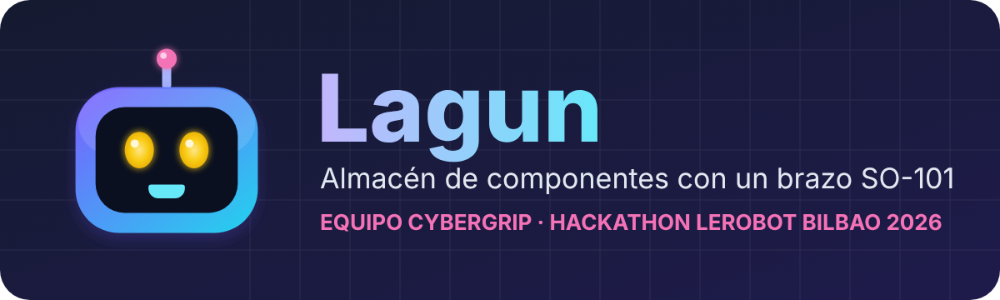

<p align="center"></p>

# 🤖 Lagun · Almacén de componentes con un brazo SO-101

**Equipo CyberGrip** · Hackathon LeRobot Bilbao 2026

Lagun («compañero» en euskera) es un asistente de almacén: le pides un componente de robótica **con la voz, con un botón o con el teclado** y un brazo **SO-101** lo coge de la estantería y lo deja en su hueco de la bandeja. También prepara **kits de montaje** completos, pieza a pieza.

El brazo **no está programado a mano**: aprendió por **imitación**. Movimos el brazo líder unas 40 veces por pieza mientras dos cámaras grababan, y entrenamos un modelo **ACT** por cada color.

> **Por qué:** en un almacén, coger la pieza correcta puede ser difícil para personas con baja visión o movilidad reducida. Con Lagun basta con pedirla.

---

## Cómo funciona

```
 Voz / botón / teclado
          │
          ▼
 ┌──────────────────────┐   API local (HTTPS)   ┌───────────────────────┐   USB   ┌──────────┐
 │ App web «PickBot»    │ ────────────────────► │ SenseCraft Robotics   │ ──────► │ SO-101   │
 │ (Lagun, cola, kits)  │  POST /api/runs/local │ (ejecuta el modelo    │         │ + 2 cám. │
 └──────────────────────┘                       │  ACT del color pedido)│         └──────────┘
                                                └───────────────────────┘
```

| Componente | Color de la pieza | Modelo |
|---|---|---|
| 📡 Sensores | Azul | ACT propio |
| ⚙️ Servomotores | Rojo | ACT propio |
| 🔋 Baterías | Verde | ACT propio |
| 💾 Microprocesadores | Negro | ACT propio |

ACT no entiende texto, así que entrenamos **un modelo por color** y la app decide cuál lanzar. Un kit es una cola de pedidos: al terminar cada pieza, la app para el modelo, espera a que SenseCraft lo libere y lanza el siguiente.

---

## Datos

Grabados con SenseCraft Robotics (brazo líder + seguidor SO-101, 2 cámaras, 30 FPS) y publicados en Hugging Face:

| Pieza | Dataset | Episodios |
|---|---|---|
| Azul | `leibar0304/database_azul` | 37 |
| Rojo | `leibar0304/database_rojo` → `database_rojo_final` | ~40 → 40 |
| Verde | [`leibar0304/database_verde`](https://huggingface.co/datasets/leibar0304/database_verde) | 36 (10 min 31 s) |
| Negro | [`leibar0304/database_negro`](https://huggingface.co/datasets/leibar0304/database_negro) + [`database_negro_v2`](https://huggingface.co/datasets/leibar0304/database_negro_v2) → `database_negro_final` | ~40 + 20 → final |

> Revisad que los nombres y números de episodios coinciden con los de vuestra cuenta antes de entregar.

## Entrenamiento e iteración

| Modelo | Dónde | Pasos | Loss final | Notas |
|---|---|---|---|---|
| Azul | RTX 4070 Laptop (local, WSL) | 20 000 | 0,107 | Funciona bien |
| Verde | RTX 4070 Laptop (local, WSL) | 40 000 | 0,108 | ~8,4 epochs, 1 h 37 min |
| Rojo v1 | SenseCraft Cloud | 40 000 | 0,205 | Primera versión |
| Negro v2 | SenseCraft Cloud (RTX 5090 D) | 50 000 | 0,192 | 6 de 10 aciertos en pruebas |
| **Rojo final** | SenseCraft Cloud (RTX 5090 D) | 40 000 | **0,189** | Nuevo dataset de 40 episodios; mejora al rojo anterior (0,205) |
| **Negro final** | SenseCraft Cloud (RTX 5090 D) | 40 000 | — | Nuevo dataset tras los fallos del negro v2 |

**Lo que aprendimos iterando:**
- **Pasos y epochs.** epochs ≈ pasos × batch ÷ frames del dataset. Con pocos episodios, subir los pasos (20 000 → 40 000) dio modelos más estables; apuntamos a unas 8-11 epochs.
- **El negro fue el difícil.** Grabamos 20 episodios más y un reentreno corto (15 000 pasos) salió peor. Lo reentrenamos con más pasos y comparamos modelos con 10 intentos reales cada uno, porque el loss de la nube y el local no son comparables. Al final grabamos datasets nuevos y más consistentes para el rojo y el negro (`*_final`, 40 episodios) y los entrenamos a 40 000 pasos.
- **El robot no sabe cuándo parar.** ACT repite lo que vio (~17 s por episodio); si le dejas más tiempo, improvisa. La app corta el modelo al terminar y tiene un botón «Pieza entregada».
- **Cámaras en WSL:** con usbipd los frames MJPEG llegaban corruptos, así que grabamos en Windows con SenseCraft y entrenamos en WSL con la GPU.

---

## Reproducirlo

### 1. Entrenar un color con la GPU (Ubuntu / WSL)
```bash
bash scripts/entrenar_gpu.sh leibar0304/database_verde verde 40000
```
Crea el entorno `lerobot06` (LeRobot 0.6.0, la misma versión que SenseCraft), entrena ACT con CUDA y deja `modelo-verde.zip` listo para SenseCraft. Las rutas apuntan a `/mnt/c/Users/eriel/Desktop`: cámbialas por las tuyas.

Otros scripts:
- `scripts/empaquetar.sh <color>` — vuelve a empaquetar un entrenamiento sin reentrenar.
- `scripts/entrenar_hf.sh` / `scripts/descargar_modelo_hf.sh` — alternativa con Hugging Face Jobs.

### 2. Importar el modelo en SenseCraft (PowerShell)
```powershell
curl.exe -sSk -X POST -H "Content-Type: application/zip" --data-binary "@modelo-verde.zip" "https://127.0.0.1:18100/api/models/import-file?name=modelo-verde"
```
El zip lleva un `manifest.json` con `train_robot_type: so_follower` para que SenseCraft lo acepte con el SO-101.

### 3. Abrir la app
1. Abre SenseCraft Robotics y acepta una vez su certificado en el navegador: `https://127.0.0.1:18100/api/models`.
2. Abre `app/robot-pedidos.html` (o sírvela: `python3 -m http.server 8000` dentro de `app/` y entra en `http://localhost:8000/robot-pedidos.html`).
3. En **⚙️ Configuración**, asigna un modelo a cada color y ajusta los segundos de **Arranque** y **Movimiento**.
4. Pide una pieza: botón, teclas **1-4**, o **🎙️ Hablar** («necesito algo para medir distancias», «prepárame el kit del brazo», «Lagun, preséntate»). **Esc** o «para» detiene el robot.

Sin robot, marca **Modo simulación** para probar la app.

### 4. Voz de Lagun (opcional)
Las frases de Lagun están en `app/voz/frases.tsv`. Con una cuenta de ElevenLabs, `scripts/generar_voz.ps1` (Windows) o `scripts/generar_voz.sh` (Linux) genera un audio por frase en `app/voz/`. Si no hay audio, la app usa la voz del navegador.

---

## Funciones de la app

- Pedidos por **voz** (Web Speech API), botón o teclado, con cola de pedidos.
- **Lagun**: asistente con cara animada que entiende peticiones por intención («algo para medir distancias» → sensores), se presenta y cuenta cómo aprendió.
- **Kits de montaje**: seguidor de línea, brazo robótico y estación meteorológica.
- **Parada de emergencia** (Esc / «para»), stock, historial con ✅/❌, tasa de éxito y tiempo medio, exportación CSV.
- Modo claro / oscuro y 4 temáticas.

## Licencia

MIT. Datasets en Hugging Face bajo la cuenta `leibar0304`.
